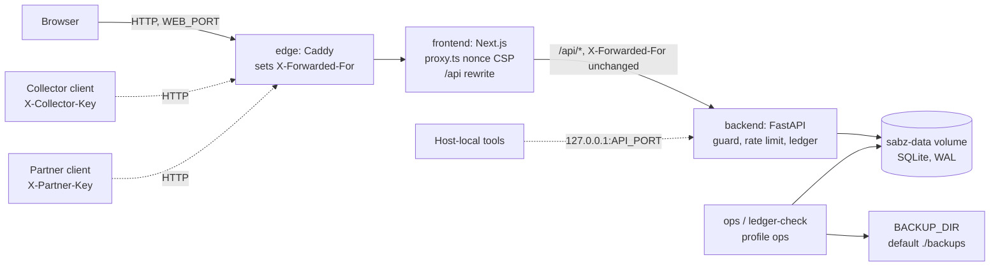
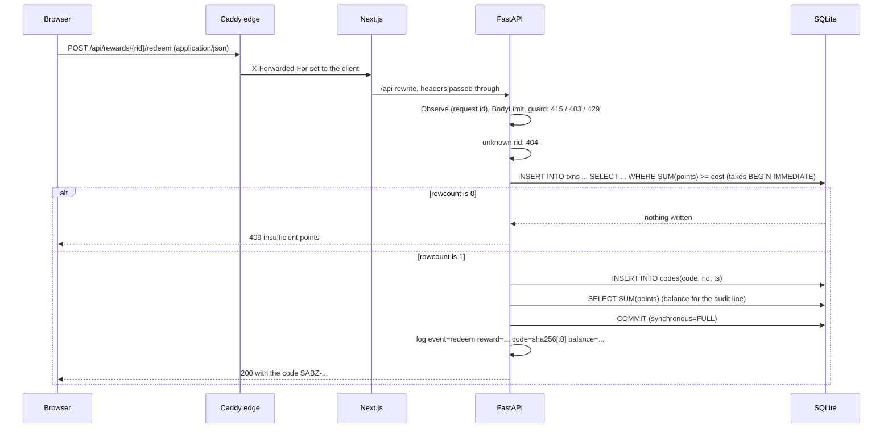

# Architecture

This document describes how SabzBank is put together: the four runtime components and the trust boundaries between them, the path a request takes, the SQLite data model and its migration ladder, how the money path stays correct under concurrency, the background sweep, what the system logs, and every configuration variable. It is the reference the other documents point to. Source of truth: [backend/main.py](../backend/main.py), [backend/ops.py](../backend/ops.py), [docker-compose.yml](../docker-compose.yml), [frontend/next.config.ts](../frontend/next.config.ts) and [frontend/proxy.ts](../frontend/proxy.ts).

## Components

| Component | Runs as | Image | Listens | Role |
|---|---|---|---|---|
| `edge` | Caddy 2, uid 65534 | `caddy:2-alpine` pinned by digest | `:80` in the container, published on `${WEB_PORT:-3026}` | The only public entry. `caddy reverse-proxy --from :80 --to frontend:3000`. Replaces any client-sent `X-Forwarded-For` with the client's address. No TLS, no admin API in this mode |
| `frontend` | Next.js 16 standalone server, uid 1000 | built from `frontend/Dockerfile` | `:3000`, not published | Server-renders the six pages, sets a per-request nonce CSP (`proxy.ts`) and static security headers (`next.config.ts`), and rewrites `/api/*` to the backend |
| `backend` | uvicorn + FastAPI, uid 10001 | built from `backend/Dockerfile` | `:8000`, published on `${API_BIND:-127.0.0.1}:${API_PORT:-8026}` | The API, all business rules, the ledger |
| `sabz-data` volume | owned by uid 10001 | named volume | | `/data/sabz.db` plus its `-wal` and `-shm` files |
| `ops`, `ledger-check` | uid 10001, profile `ops` | the backend image | | One-shot jobs: `python ops.py backup /backups` and `python ops.py check` |

All services share the default compose network. Only the edge and the backend's loopback port are published.

## Trust boundaries

| # | Boundary | What crosses it | What the inner side trusts | Where it is enforced |
|---|---|---|---|---|
| 1 | Internet to edge | Every client request | Nothing from the client. Caddy overwrites `X-Forwarded-For` | `docker-compose.yml`, service `edge` |
| 2 | Edge to frontend | Requests with one `X-Forwarded-For` entry | The frontend has no published port, so only the edge reaches it | `docker-compose.yml` (no `ports` on `frontend`) |
| 3 | Frontend to backend | `/api/*` rewrites, headers passed through, including the key headers | With `TRUST_PROXY=1` (set in compose), the backend keys rate limits on the rightmost `X-Forwarded-For` entry | `client_ip()` and `charge()` in `backend/main.py`; uvicorn runs with `--no-proxy-headers` |
| 4 | Collector and partner to backend | `X-Collector-Key`, `X-Partner-Key` | A constant-time match against the configured keys | `require_key()` in `backend/main.py` |
| 5 | Host to backend | Loopback calls to `API_PORT` | Host-local processes are trusted. They can forge `X-Forwarded-For`. Calls with no header or with several entries log `event=edge_bypass`; a single forged entry is not detected | compose `ports` binding, `charge()` |
| 6 | Backend to disk | SQLite file I/O | The volume is owned by uid 10001; the root filesystem is read-only | `backend/Dockerfile`, compose `read_only` |
| 7 | Operator to ops jobs | Backup directory, the volume | The operator | compose profile `ops` |

The citizen side has no authentication: there is one demo user. [SECURITY.md](SECURITY.md) covers what that leaves open.

## Request flow

1. **Edge.** Caddy accepts the connection on `:80`, sets `X-Forwarded-For` to the client address, and proxies to `frontend:3000`.
2. **Next.js.**
   - Page routes pass through `proxy.ts` (Next 16's renamed middleware). It makes a 128-bit nonce, builds the CSP (`script-src 'self' 'nonce-…' 'strict-dynamic'`, `object-src 'none'`, `frame-ancestors 'none'` and the rest), forwards it on the request so Next stamps the nonce on its script tags, and sets it on the response. HSTS is added only when the request came over HTTPS. The matcher skips `/api/`, `/_next/static`, `/_next/image`, `favicon.ico`, `icon.svg` and router prefetches.
   - Static headers for every path come from `next.config.ts`: `X-Content-Type-Options`, `Referrer-Policy`, `X-Frame-Options: DENY`, `Permissions-Policy`, `Cross-Origin-Opener-Policy`. `X-Powered-By` is off.
   - `/api/:path*` is rewritten to `${BACKEND_URL}/api/:path*`. `BACKEND_URL` is baked in at build time (`http://backend:8000` in compose). `experimental.proxyClientMaxBodySize: "16kb"` caps the copy of the body that Next buffers.
3. **FastAPI pipeline**, outermost first:
   - `Observe` (pure ASGI): makes a 12-hex-character request id, stores it in `scope["rid"]`, adds `x-request-id`, `x-content-type-options: nosniff` and `cache-control: no-store` to every response except an unhandled 500 (Starlette's outer error handler answers that one), and writes one access-log line when the response ends.
   - `BodyLimit` (pure ASGI): 413 when `Content-Length` or the streamed body exceeds `MAX_BODY` (16384 bytes), before any parsing.
   - Routing, then the app-wide dependency `guard()`: for a POST, 415 without `Content-Type: application/json` and 403 for `Sec-Fetch-Site: cross-site`; then `charge()` takes a token from the client's bucket or answers 429 with `Retry-After`.
   - The route handler, which opens its own SQLite connection per request.
   - Exception handlers: `RequestValidationError` becomes a 422 without the rejected input (and runs `guard()` first if FastAPI rejected the body before the dependency ran); `sqlite3.OperationalError` becomes a 503 with `Retry-After: 1`.

Unrouted paths (Starlette's 404) and 413s are not charged to a bucket: both are rejected before routing.

## Data model

SQLite in WAL mode, one file at `DB_PATH`. The schema is created by the migration ladder in `backend/main.py`.

| Table | Columns | Meaning |
|---|---|---|
| `pickups` | `id INTEGER PRIMARY KEY, created TEXT, day TEXT, slot TEXT, address TEXT, items TEXT, status TEXT, est INTEGER, points INTEGER DEFAULT 0, weight REAL DEFAULT 0` | One pickup request. `items` is JSON, material to kg. `status` is `scheduled`, `delivered` or `canceled`. `est` is the estimate at booking; `points` and `weight` are set on completion, when `items` is overwritten with the weighed values |
| `txns` | `id INTEGER PRIMARY KEY, ts TEXT, kind TEXT, ref TEXT, points INTEGER` | The ledger. `kind` is `pickup` (ref = pickup id), `redeem` (ref = reward id, negative points) or `mission` (ref = mission id). Balance is `SUM(points)`; lifetime is the sum of positive rows |
| `missions_done` | `id TEXT PRIMARY KEY, ts TEXT` | Missions answered correctly (global: one demo user) |
| `codes` | `code TEXT PRIMARY KEY, rid TEXT, ts TEXT, used TEXT` | Reward codes, stored in clear. `used` is the spend timestamp, NULL until a partner spends the code |

Indexes:

| Index | Columns | Serves |
|---|---|---|
| `pickups_status_day` | `pickups(status, day)` | The next scheduled pickup in `/api/state`, the overdue sweep |
| `pickups_day_id` | `pickups(day, id)` | The keyset cursor of `GET /api/pickups` |
| `txns_ts_id` | `txns(ts, id)` | `GET /api/transactions` ordering |
| `txns_once` (UNIQUE, partial) | `txns(kind, ref) WHERE kind IN ('pickup', 'mission')` | Award-once in the database: one credit per pickup and per mission. Redeems repeat freely |

There is no user column, no `CHECK` and no `FOREIGN KEY`. SQLite cannot add those with `ALTER TABLE`, so they come with the table rebuild of the accounts migration (phase B in [IMPLEMENTATION_PLAN.md](IMPLEMENTATION_PLAN.md)). Ids are `INTEGER PRIMARY KEY` without `AUTOINCREMENT`, so SQLite may reuse the highest id after a delete; nothing deletes rows today.

### Migration ladder

`PRAGMA user_version` counts the steps applied. `MIGRATIONS` in `backend/main.py` is an append-only list; a shipped step is never edited.

| Version | Step |
|---|---|
| 1 | The pre-versioning schema with `CREATE … IF NOT EXISTS`, so an unversioned database (version 0) adopts it in place |
| 2 | `CREATE UNIQUE INDEX txns_once ON txns(kind, ref) WHERE kind IN ('pickup', 'mission')` |

`init_db()` runs at import time, before the app serves:

- It opens the file with `autocommit=True` (Python 3.12), so `executescript` keeps an explicit `BEGIN` open.
- For each step: `BEGIN IMMEDIATE`, read `user_version` under the write lock, run the script plus `PRAGMA user_version=N`, `COMMIT`. Two workers starting at once cannot both apply a step.
- A failing step raises before its `COMMIT`, the connection rolls it back whole, and the process exits. A database that already holds a duplicate pickup or mission credit fails step 2 this way; [OPERATIONS.md](OPERATIONS.md) has the pre-upgrade check.
- With `DEMO_MODE=1`, it then seeds the sample history into an empty database, under the write lock. Production starts empty at 0 points.

## Concurrency and transactions

Each request opens its own connection with `sqlite3.connect(DB_PATH, isolation_level="IMMEDIATE")`, so the first write statement takes the write lock (`BEGIN IMMEDIATE`) and two writers queue instead of interleaving. The busy timeout is `connect()`'s default of 5 seconds; past it, the handler raises `OperationalError` and the client gets 503 with `Retry-After: 1`. Every connection sets `PRAGMA synchronous=FULL`, so a committed redeem or code spend survives power loss (measured at about 2 to 2.5 ms extra per commit).

| Operation | How it stays correct | Test section in `backend/test_api.py` |
|---|---|---|
| Redeem | Balance check and debit in one statement: `INSERT INTO txns … SELECT … WHERE (SELECT SUM(points) FROM txns) >= cost`. `rowcount` 0 means 409. The code row is inserted in the same transaction | `redeem_races`, `redeem_at_exact_balance` |
| Complete | `UPDATE pickups SET status='delivered' … WHERE id=? AND status='scheduled'`; `rowcount` 0 means 409. The credit row is in the same transaction, and `txns_once` refuses a second credit | `complete_races`, `status_action_matrix`, `award_once_index` |
| Cancel | `UPDATE … WHERE id=? AND status='scheduled'` | `status_action_matrix` |
| Daily cap | `BEGIN IMMEDIATE` before the `COUNT(*)`, so parallel creates cannot overshoot `PICKUPS_PER_DAY` | `daily_cap` |
| Mission answer | `INSERT OR IGNORE INTO missions_done` plus `rowcount`; the loser of a double submit gets 409 | `missions` |
| Code spend | `UPDATE codes SET used=? WHERE code=? AND used IS NULL` | `code_lookup_and_use` |
| State read | An explicit `BEGIN` before the three SELECTs, so balance, impact and the next pickup come from one WAL snapshot even while a complete commits | `state_reads_one_snapshot` |

## Background sweep

The FastAPI lifespan starts one asyncio task, `expire_hourly()`. It runs `expire_overdue()` in a worker thread at startup and then every hour. `expire_overdue()` cancels scheduled pickups whose day is more than `OVERDUE_DAYS` (7) days in the past and logs `event=expire_overdue count=N`. An exception is logged as `event=expire_overdue_failed` and the loop continues. Shutdown cancels and awaits the task. With several workers each would run it, which is harmless: it is one idempotent `UPDATE`. The image runs one uvicorn worker.

Overdue pickups between 1 and 7 days old stay `scheduled` until the sweep, but `/api/state` only picks a next pickup with `day >= today`, so they never mask the real one.

## Observability

- **Request id.** `Observe` makes a fresh `secrets.token_hex(6)` per request. It is returned as `x-request-id` and printed on the access line and on every audit line of that request. An incoming `X-Request-Id` is not used.
- **Access line**, one per request: `<rid> <METHOD> <path> <status> <ms>ms ip=<client>`. Level ERROR for 5xx, WARNING for 403, 409, 413, 415 and 429, INFO otherwise. The path is URL-quoted and cut to 200 characters; a reward code in the path becomes `code#<sha256[:8]>`; the ip field is quoted and cut to 64 characters.
- **Audit lines**, one per business or security event: `event=<name> rid=<rid> key=value …`, every value URL-quoted so no field can forge another field or line. No key, address or full code is logged; keys and codes appear as sha256 prefixes. The event list is in [BACKEND.md](BACKEND.md).
- **Format.** Python logging to stdout, `%(asctime)s %(levelname)s %(message)s`. Uvicorn's own access log is off (`--no-access-log`). Docker's json-file driver keeps 5 files of 10 MB per service.
- **No metrics or tracing.** Deliberate for one instance; [BACKEND.md](BACKEND.md) names the trigger for each.

## Configuration

Backend (`backend/main.py`, `backend/ops.py`):

| Variable | Default | Meaning |
|---|---|---|
| `DB_PATH` | `data/sabz.db` (the image sets `/data/sabz.db`) | The SQLite file. `ops.py` reads the same variable |
| `DEMO_MODE` | `0` (compose: `${DEMO_MODE:-0}`) | `1` serves `/docs`, `/redoc`, `/openapi.json`, seeds an empty database, and lets `complete` run without a key and on any day |
| `COLLECTOR_KEY` | empty | Shared secret sent as `X-Collector-Key` to complete a pickup outside demo mode. A comma list (`new,old`) during rotation. Each key needs 32+ characters with 10+ distinct ones, or startup stops. Empty means every complete call gets 403 |
| `PARTNER_KEY` | empty | Shared secret sent as `X-Partner-Key` to look up or spend a reward code, in demo mode too. Same format and rules as `COLLECTOR_KEY` |
| `TRUST_PROXY` | off (compose sets `1`) | `1` keys rate limits on the rightmost `X-Forwarded-For` entry and logs `event=edge_bypass` when that header is missing or has several entries. Only behind the edge |
| `TZ` | `Asia/Tehran` in the image | The OS zone only. The app computes dates with a fixed UTC+03:30 offset |
| `PYTHONDONTWRITEBYTECODE`, `PYTHONUNBUFFERED` | `1` in the image | No `.pyc` writes on the read-only root; unbuffered logs |

Compose (`docker-compose.yml`):

| Variable | Default | Meaning |
|---|---|---|
| `WEB_PORT` | `3026` | Host port of the edge |
| `API_BIND` | `127.0.0.1` | Host address of the backend port. Do not widen it: with `TRUST_PROXY=1`, a direct caller can forge `X-Forwarded-For` |
| `API_PORT` | `8026` | Host port of the backend |
| `BACKUP_DIR` | `./backups` | Host directory the `ops` job writes backups into; must be writable by uid 10001 |
| `COMPOSE_PROJECT_NAME` | the compose project name | Names the backend image (`<project>-backend`) that the `ops` jobs reuse |

Frontend (`frontend/Dockerfile`, `frontend/next.config.ts`):

| Variable | Default | Meaning |
|---|---|---|
| `BACKEND_URL` | build arg `http://backend:8000`; `http://localhost:8000` in `next.config.ts` when unset | Target of the `/api` rewrite, baked in at build time |
| `NODE_ENV` | `production` in the runtime image | `development` adds `'unsafe-eval'` to the CSP for `next dev` |
| `PORT`, `HOSTNAME` | `3000`, `0.0.0.0` | Where the standalone server listens |
| `NEXT_TELEMETRY_DISABLED` | `1` | No Next.js telemetry |

Scripts and CI variables are listed in [DEVSECOPS.md](DEVSECOPS.md) and [QA_PLAN.md](QA_PLAN.md).
