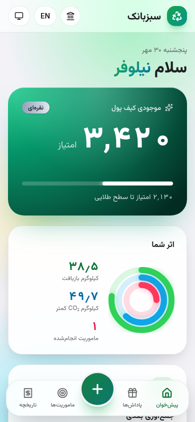
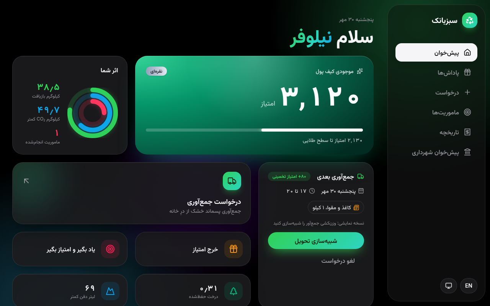
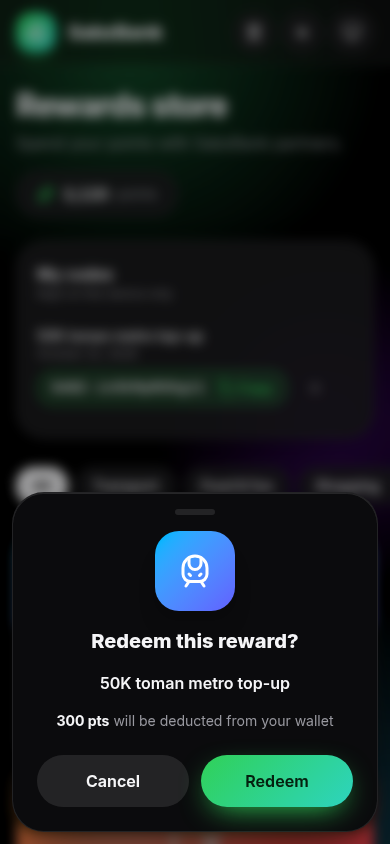
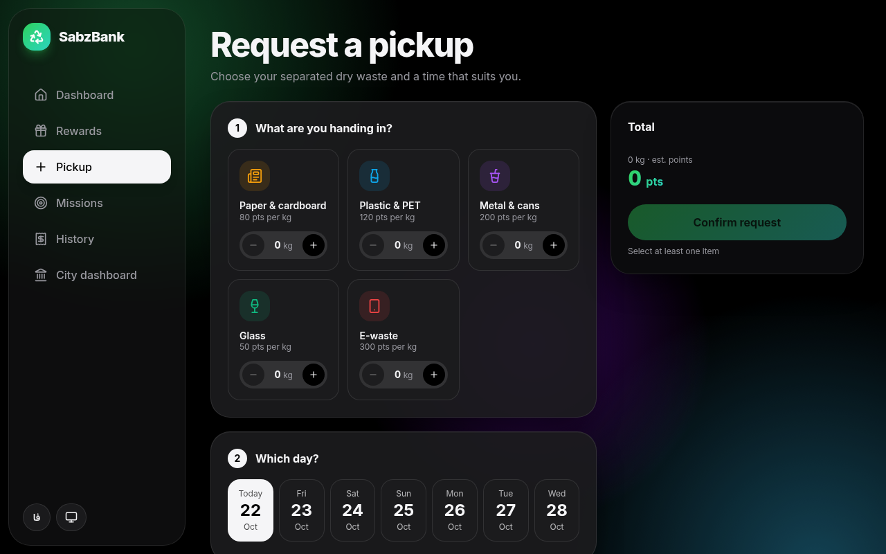
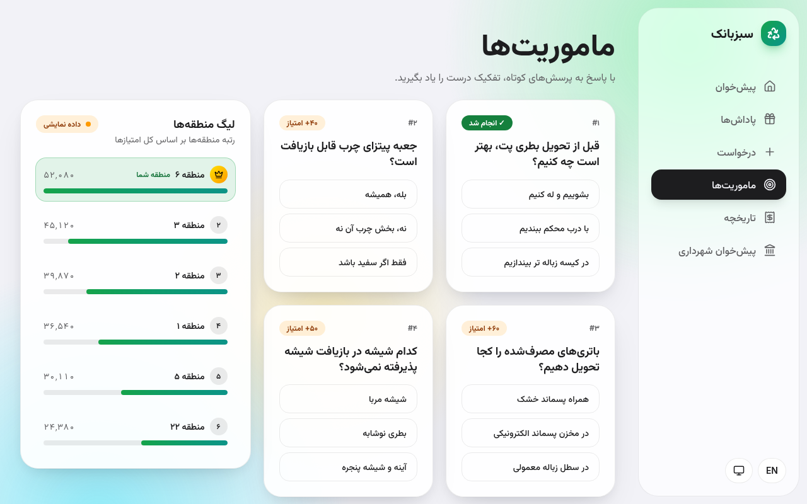
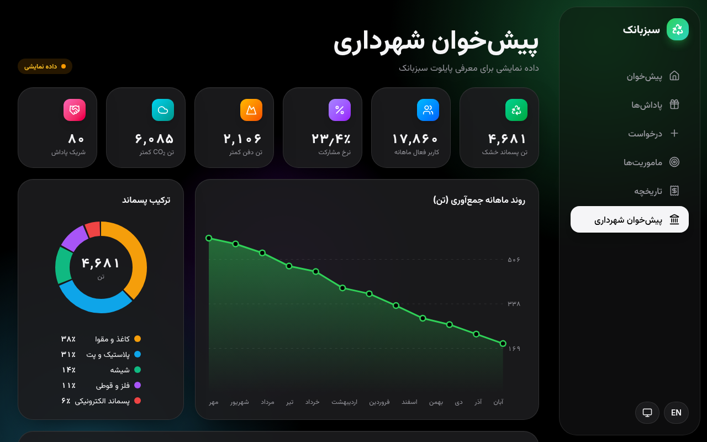

# SabzBank documentation

This folder documents SabzBank (سبزبانک) as it is built on branch `audit/followups`: what the product does, how the FastAPI backend, the Next.js frontend and the Caddy edge fit together, how to run, operate, test and secure it, and what comes next. Every statement here was checked against the code; where the docs and the code disagree, the code wins and the docs have a bug. Start with the quick start below, then pick the document for your role from the index.

## Index

| Document | For | What it covers |
|---|---|---|
| [ARCHITECTURE.md](ARCHITECTURE.md) | everyone | Components, trust boundaries, request flow, data model, transactions, configuration |
| [API.md](API.md) | client and integration developers | Every endpoint, headers, errors, rate limits, curl examples |
| [BACKEND.md](BACKEND.md) | backend developers | Module layout, guards, keys, constants, logging, tests, performance, what was not adopted |
| [OPERATIONS.md](OPERATIONS.md) | operators | Start and stop, health, backups and restore, key rotation, alerts, incident runbooks |
| [SECURITY.md](SECURITY.md) | security reviewers | Trust boundaries, control map, residual risks, the checklist for real authentication |
| [DEVSECOPS.md](DEVSECOPS.md) | maintainers | CI jobs, gates, pinning, Dependabot, secret scanning, SBOM, suppressions |
| [DOCKER_HARDENING.md](DOCKER_HARDENING.md) | operators, reviewers | Each container control, where it lives, and the tool evidence |
| [THREAT_INTEL.md](THREAT_INTEL.md) | maintainers | The dependency threat-intelligence lifecycle |
| [IMPLEMENTATION_PLAN.md](IMPLEMENTATION_PLAN.md) | tech lead, PM, founder | The next five phases, step by step, with the decisions each needs |
| [ROADMAP.md](ROADMAP.md) | product, tech lead | PWA, collector and partner screens, Android and iOS packaging |
| [UI_UX.md](UI_UX.md) | designers, frontend developers | Design principles, tokens and contrast, theming, RTL, the six pages, feedback states, accessibility, visual QA |
| [QA_PLAN.md](QA_PLAN.md) | QA | Acceptance criteria, boundary values, the automation pyramid, the manual checklist |
| [ROLE_REVIEWS.md](ROLE_REVIEWS.md) | everyone | What the five role reviews recommended and what happened to each item |
| [COMPLETE_IMPLEMENTATION_REPORT.md](COMPLETE_IMPLEMENTATION_REPORT.md) | reviewers | Scope, stack, traceability, status of every finding, verification evidence |

Outside this folder:

| Document | What it is |
|---|---|
| [../README.md](../README.md) | The short repository readme with the run commands |
| [../SECURITY_AUDIT.md](../SECURITY_AUDIT.md) | The security, performance and UI/UX audit (threat model, findings B, N, P, I, F, FP), corrected to this branch, with the follow-up pass of 2026-10-16 to 2026-10-22 |
| [../LAST_Report.md](../LAST_Report.md) | The narrative report of all work so far |
| [../threat-intel/README.md](../threat-intel/README.md) | The triage file's readme: run the threat brief, accept a risk |
| [../graphify-out/GRAPH_REPORT.md](../graphify-out/GRAPH_REPORT.md) | The knowledge-graph report of the code (communities, most-connected nodes) |

## The product on one screen

SabzBank turns separated dry waste into points.

1. A citizen requests a doorstep pickup: which materials (paper and cardboard, plastic and PET, metal and cans, glass, e-waste), how many kilograms, which day in the next 14, which of four time slots, and an address.
2. A collector weighs the bags and completes the pickup. Points land in the citizen's wallet (کیف پول). Each material has its own points per kilogram.
3. The citizen spends points on partner rewards (پاداش‌ها). Redeeming (فعال‌سازی) debits the wallet and returns a reward code. A partner looks the code up and spends it once.
4. Short quiz missions (ماموریت‌ها) teach correct sorting and pay points once each.
5. Lifetime points set a tier (bronze, silver, gold). A district league ranks Tehran districts.
6. A municipality dashboard (پیش‌خوان شهرداری) shows city totals. Its figures are sample data from a seeded generator plus the user's real delivered weight, and the page labels them as sample data (داده نمایشی).

What the MVP is not yet:

- **One demo user.** There are no accounts. Anyone who can reach the site acts as that user. This is a settled MVP decision; accounts are phase B of [IMPLEMENTATION_PLAN.md](IMPLEMENTATION_PLAN.md).
- **No real weighing.** `POST /api/pickups/{pid}/complete` multiplies the declared weight by a random factor between 0.9 and 1.1, in production too. Phase A replaces this.
- **Collector and partner are API clients only.** They authenticate with a shared key header (`X-Collector-Key`, `X-Partner-Key`). There are no collector or partner screens yet.

The UI is Persian (right to left) by default, with English, and light, dark or automatic theme.

## Quick start

### Demo

```bash
DEMO_MODE=1 docker compose up --build
```

- Web: http://localhost:3026 (set `WEB_PORT` to change it).
- API docs, demo only: http://localhost:8026/docs (set `API_PORT` to change it; the port is bound to 127.0.0.1).
- Demo mode seeds a sample history (balance 3420, silver tier) into an empty database, serves `/docs`, and lets the dashboard's "Simulate delivery" button (شبیه‌سازی تحویل) complete a pickup without a collector key.

### Production

```bash
# keys: 32+ characters with 10+ distinct ones, or the backend refuses to start
export COLLECTOR_KEY="$(python3 -c 'import secrets; print(secrets.token_urlsafe(32))')"
export PARTNER_KEY="$(python3 -c 'import secrets; print(secrets.token_urlsafe(32))')"
docker compose up -d --build --wait
```

- Leave `DEMO_MODE` unset. It defaults to off, so a deploy that forgets it fails closed.
- The edge serves plain HTTP on `WEB_PORT`. The collector and partner keys travel in headers, so put TLS in front before real traffic (see [SECURITY.md](SECURITY.md), residual risks).
- Schedule the daily backup: `docker compose --profile ops run --rm ops` (see [OPERATIONS.md](OPERATIONS.md)).
- A volume created by the old root image needs a one-time `chown` first (see [OPERATIONS.md](OPERATIONS.md), "Upgrading").

### Without Docker

See [../README.md](../README.md), "Run locally".

## Status

| Area | Built | Deferred |
|---|---|---|
| Citizen app | Six pages: dashboard, pickup request, rewards, missions, history, city dashboard. fa and en, RTL and LTR, light, dark and automatic theme | Accounts and sign-in (phase B), notifications (phase D) |
| Pickups | Create, cancel, collector complete with key, 5 per day, 50 kg per pickup, missed pickups canceled after 7 days | Real measured weight (phase A), pilot-area and lead-time rules |
| Points and rewards | Atomic redeem, 72-bit reward codes, partner lookup and single-use spend, award-once enforced in the database | Code expiry, idempotent redeem, per-partner keys (phase C), points-economy anchor (phase E) |
| Backend safety | Rate limits (write and read buckets), CSRF guards, body limit, uniform 403 on keys, key rotation, safe logs, audit events, 503 on a busy database, migration ladder | Hashed codes at rest, per-user limits |
| Operations | Readiness health check, online backup with retention, ledger invariant check, hourly overdue sweep | Off-host backup copy, address retention purge |
| Containers | Non-root, read-only, no capabilities, limits, log rotation, digest pins, healthchecks, non-root edge | TLS at the edge, privileged-route allowlist, image signing |
| CI and supply chain | Tests, type check, build, pip-audit, npm audit, gitleaks, semgrep, hadolint, trivy, SBOM, compose smoke, gate; Dependabot; weekly threat brief | Frontend unit and end-to-end tests |
| Packaging | Web app | PWA, then collector and partner screens, then Android, then iOS ([ROADMAP.md](ROADMAP.md)) |

The frontend fixes from the visual QA and the role reviews are part of this branch; [UI_UX.md](UI_UX.md) describes them.

## Screenshots

These images were captured from the finished UI with `scripts/screenshots.py`. Six more are in [UI_UX.md](UI_UX.md).

| | |
|---|---|
|  |  |
| Dashboard (پیش‌خوان), light, Persian, phone | Dashboard, dark, Persian, desktop |
|  |  |
| Redeem sheet, dark, English, phone | Pickup request, dark, English, desktop |
|  |  |
| Missions (ماموریت‌ها), light, Persian, desktop | City dashboard (پیش‌خوان شهرداری), dark, Persian, desktop |

To capture them again, see [UI_UX.md](UI_UX.md), section 10, or [QA_PLAN.md](QA_PLAN.md), "Screenshots".
