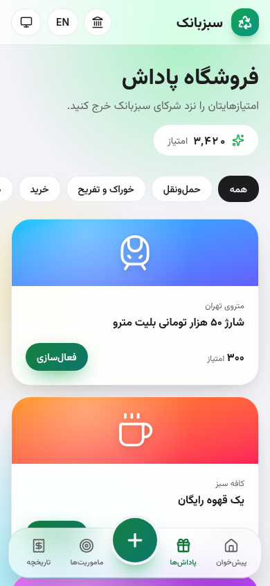
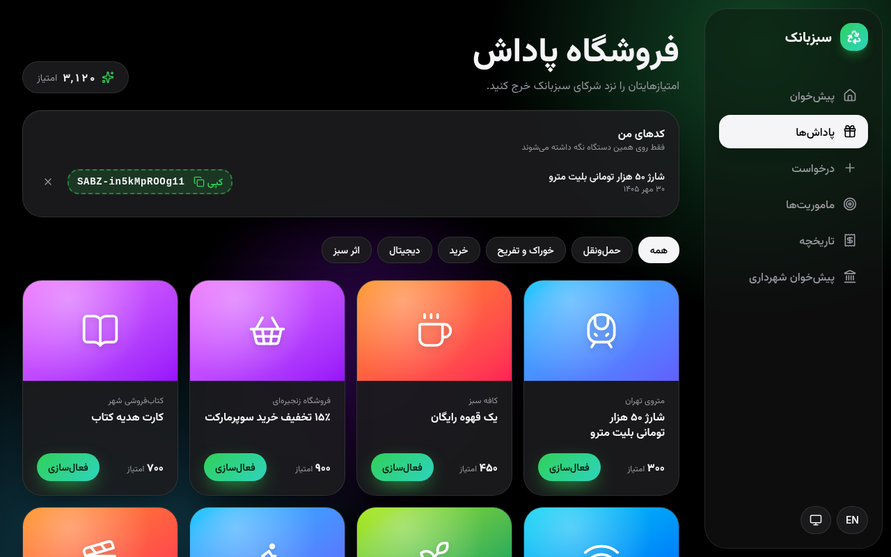
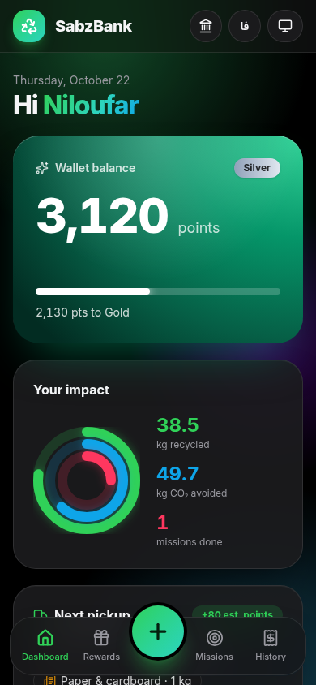
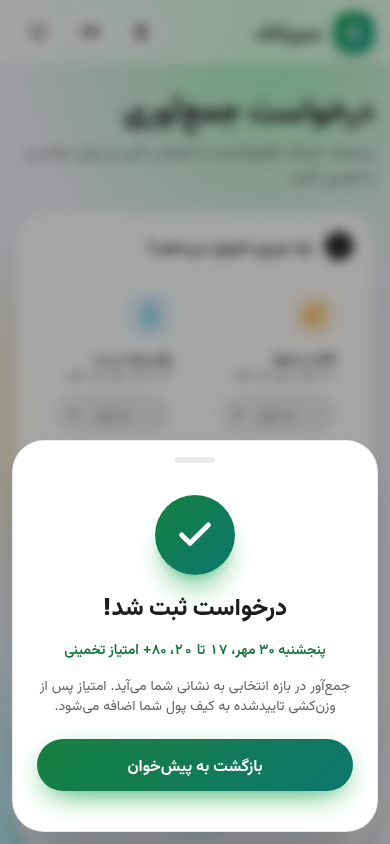
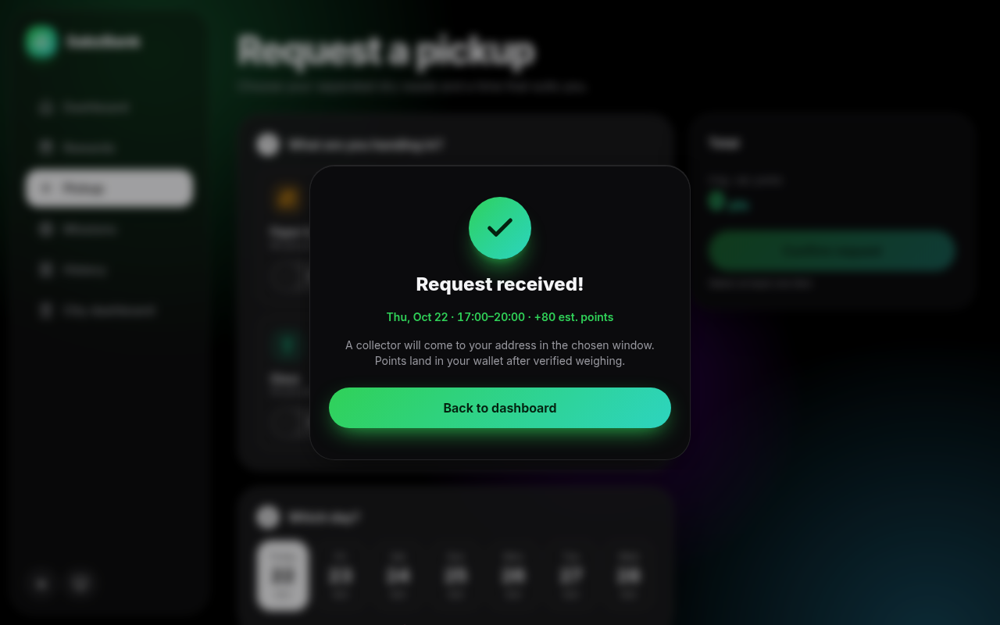
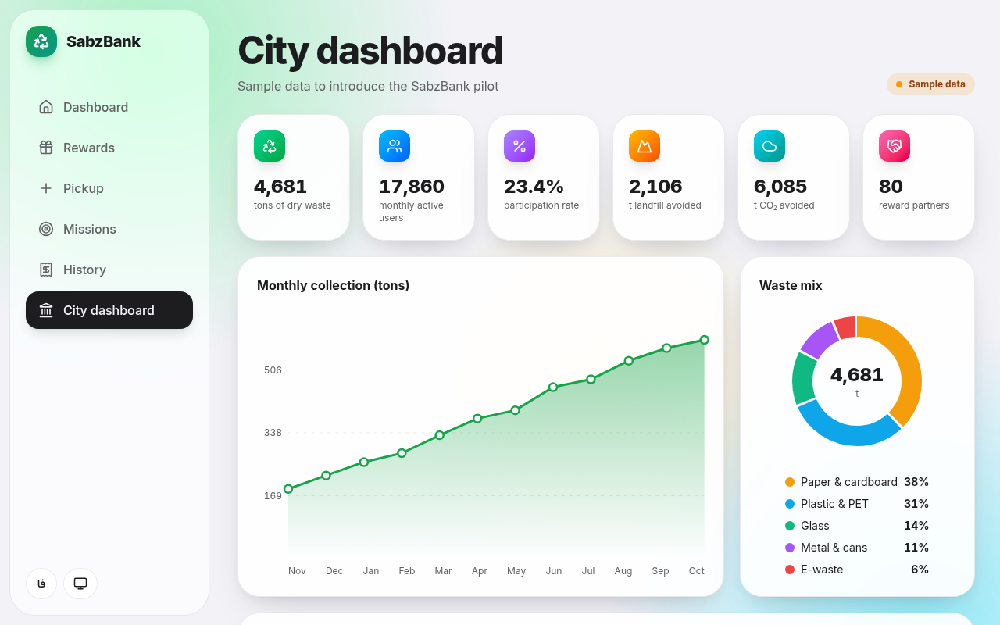

# UI and UX design

This document describes the SabzBank web app as it is built in `frontend/`: the design principles, the token system, theming, right-to-left handling, the six pages, feedback states, accessibility, and what the visual QA found and fixed. Every statement was checked against the code. Measured numbers (contrast ratios, capture results) come from the frontend builder's and the visual QA's runs in headless Chrome. They are quoted as measured at the time and are not re-measured by any test in the repository.

## 1. Design principles

The look follows Apple's platform conventions: content first, translucent material only where it floats over content, and motion that responds to the finger.

| Principle | How the code does it | Where |
|---|---|---|
| Blur only on floating chrome | `.glass` (`saturate(180%) blur(24px)`) is used only by the mobile tab bar, the mobile top bar and the desktop sidebar. The sheet backdrop has a 6 px blur. Content cards are near-solid (`--card`, 92 % light, 90 % dark), so text over them never competes with what scrolls underneath | `app/globals.css` `.glass`, `.card`, `dialog.sheet::backdrop` |
| Never glass on glass | Anything that floats over a glass bar or over content is solid: the pickup summary panel and the sheet use `.panel` (solid `--bg-2` with a lit top edge), and the language and theme buttons on the glass bars are solid chips | `.panel`, `components/shell.tsx` |
| Press feedback without bounce | `.press` scales a control to 0.96 in 60 ms while it is held and returns it in 160 ms on `cubic-bezier(.2,.8,.2,1)`. The curve decelerates and never overshoots, like a critically damped spring | `.press`, `.press:active` |
| Interruptible drag-to-dismiss sheet | On phones the sheet follows the finger 1:1 (at once on the handle, elsewhere after 10 px, so buttons inside still get their tap) and rubber-bands past the top. On release it takes the velocity of the last 100 ms, projects where a flick would come to rest (deceleration rate 0.998), and dismisses if that point is past half the sheet's height. A spring then settles it: response 0.3 s, damping ratio 1 (no bounce), or 0.8 after a flick faster than 300 px/s. A touch on a moving sheet cancels the spring and picks the sheet up from its live on-screen position, even during the entrance | `components/ui.tsx` `Sheet` |
| One surface per size | Phones get a bottom sheet with a grab handle; from 768 px the same `<dialog>` is a centred card that scales in and has no drag | `dialog.sheet` media queries |
| Entrances that leave nothing behind | Page sections rise in sequence (`.stagger`). The fill mode is `backwards`, so a finished entrance leaves no `transform` or `filter` on the element. Either one would make it the containing block of a `position: fixed` child (this was the pinned-bar defect, section 9) | `.stagger` |
| Numbers that move | `Counter` springs to a new value over 1.4 s (exponential ease-out) and restarts from the value on screen. It writes the DOM directly, so there is no React render per frame | `Counter` |
| Theme and language switch | A View Transition reveals the new theme or language as a circle growing from the tapped button. Browsers without View Transitions switch instantly | `shell.tsx` `reveal` |

System preferences are honoured:

- **Reduced motion.** Animations and transitions drop to about 0 ms. Entrances and the success badge become 0.3 s cross-fades with no travel. The sheet fades instead of sliding and cannot be dragged. Counters jump to the new value, and the circular reveal is skipped.
- **Reduced transparency.** Glass bars, cards and chips become solid `--bg-2`, and no surface blurs.
- **Increased contrast.** `--muted` and `--line` get darker (lighter in dark mode), surfaces become solid with a `--fg` border, and no surface blurs.

## 2. Tokens

Colours are CSS custom properties on `:root` and `[data-theme="dark"]` in `app/globals.css`, exposed to Tailwind through `@theme inline` (`bg-brand-fill`, `text-brand-text` and so on). The bright brand colours stay on rings, icons and gradients. Text and solid fills use dedicated tokens that meet WCAG AA.

| Token | Light | Dark | Used for |
|---|---|---|---|
| `--bg`, `--bg-2` | `#f2f2f7`, `#ffffff` | `#000000`, `#0b0b0d` | Page, solid panels |
| `--fg`, `--muted` | `#1d1d1f`, `#636366` | `#f5f5f7`, `#98989f` | Text, secondary text |
| `--brand`, `--brand-2` | `#16a34a`, `#0d9488` | `#30d158`, `#2dd4bf` | Rings, icons, gradients, focus rings |
| `--brand-text` | `#14733a` | `#30d158` | Brand-coloured text up to 18 px, pill labels |
| `--brand-fill` → `--brand-fill-2` | `#15803d` → `#0f766e` | `#30d158` → `#2dd4bf` | Primary buttons, solid badges, the pickup button in the tab bar |
| `--on-brand` | `#ffffff` | `#04210f` | Text on `--brand-fill`. White on the bright dark-mode mint is 2:1, near-black is 8.5:1 |
| `--amber-text`, `--rose-text`, `--sky-text` | `#92400e`, `#e11d48`, `#0369a1` | `#fbbf24`, `#ff375f`, `#0ea5e9` | Status pills, impact figures |
| `--danger` | `#b91c1c` | `#f87171` | Error text |

Measured contrast before and after the token change (alpha layers composited on their real backdrop; 4.5:1 needed for normal text, 3:1 for large):

| Pair | Before | After |
|---|---|---|
| Primary button, light (both gradient ends) | 3.30, 3.74 | 5.02, 5.47 |
| Primary button, dark (both gradient ends) | 2.02, 1.86 | 8.45, 9.17 |
| "Done" badge, light / dark | 3.30 / 2.02 | 5.02 / 8.45 |
| Active tab label on the glass bar, light | 3.19 | 5.73 |
| Brand pill on `--brand-soft` | 2.86 | 5.14 |
| Brand text on a card | 3.27 | 5.88 |
| Amber "awaiting pickup" pill | 2.83 | 6.30 |
| Mission reward pill (rose changed to amber), light / dark | 3.11 / 4.23 | 6.30 / 8.02 |
| City badge ("LIVE" changed to "Sample data"), light / dark | 2.62 / 8.42 | 5.72 / 10.39 |
| Impact figures, 24 px bold (3:1 needed): kg, CO₂, missions | 2.00, 2.75, 3.49 | 5.88, 5.88, 4.66 |
| Error text, light / dark | 3.73 / 4.67 | 6.42 / 6.35 |
| Muted text on the page background | 4.54 | 5.37 |
| Muted text on the grey track (inactive tab, time slots) | 3.82 | 4.51 |

`--sky-text` was deepened once more, from `#0284c7` (4.06:1, enough only for large text) to `#0369a1` (5.88:1), so every `*-text` token meets 4.5:1. The dark tokens that did not change measure 4.99:1 to 9.61:1.

## 3. Light, dark and automatic

- The theme lives in `data-theme` on `<html>`. The choice cycles automatic → light → dark and is kept in `localStorage` under `theme`.
- An inline script in `app/layout.tsx` (it carries the CSP nonce) applies the saved choice before the first paint, so a saved dark theme never flashes light. Only `light` and `dark` are accepted from storage; anything else means automatic.
- Automatic follows the operating system, including a change while the page is open (`matchMedia` listener).
- The sidebar and the top bar each render the theme button, and CSS hides one of them. Both read one shared state, so they always agree.
- The theme button is named after the current mode («پوسته: خودکار», "Theme: Automatic"). The browser chrome colour follows the OS scheme through `themeColor`.

## 4. Right to left and left to right

- **Language.** Persian (`fa`, right to left) is the default. English is chosen with the `lang` cookie (one year, `SameSite=Lax`, `Secure` on HTTPS). The server renders `<html lang dir>` from the cookie, so the first paint already has the right direction. The language button is named in its target language («فارسی» / "English") and carries that `lang`.
- **Layout.** Spacing and placement use logical properties (`start`, `end`, `ps-`, `pe-`, `inset-inline-*`), so the sidebar and the skip link sit on the reading side in both directions. The wallet's bright corner sits at the inline end, away from its small white label.
- **Mirrored on purpose.** The arrow on the pickup card (`rtl:-scale-x-100`), the city chart (time runs right to left in Persian), the district league bars (they grow from the inline start) and the edge fade of the day picker (it sits on the inline end). Icons without a direction are not mirrored. Reward codes are always shown left to right (`dir="ltr"`).
- **Signed numbers.** `signed()` in `lib/i18n.tsx` wraps the sign and the number in a left-to-right isolate (U+2066 … U+2069). Without it the bidi algorithm moves the sign to the right of Persian digits, and «۴۰+» reads as "forty or more". It is used for mission rewards, history amounts (+, −, ~), the next-pickup estimate, the delivery toast and the pickup success sheet.
- **Digits and dates.** Numbers use `Intl` with `fa-IR` (Persian digits and grouping). Dates use the Persian calendar (`fa-IR-u-ca-persian`). A date-only value is read at local noon, so a time zone cannot move it to the previous day. The pickup page builds its seven days on Tehran's calendar (UTC+3:30), because the API validates the day there, and it rebuilds them on every render, so a tab left open past midnight moves on to the new day.
- **Separators.** A middle dot next to Persian digits reads as a zero («۰» is a dot). The `sep` key is «، » in Persian and " · " in English, used in the material chips, the pickup summary and the success sheet. Time slots read «۸ تا ۱۱» in Persian and "8:00–11:00" in English.
- **Type.** Inter (Latin) and Vazirmatn (Arabic script) are self-hosted variable fonts through `next/font/local`, preloaded with a size-adjusted fallback. Persian titles have no negative letter spacing; English gets tight tracking on large numbers only.
- **Copy.** Persian wording follows the Persian UX-writing vocabulary: پیش‌خوان for dashboard, کیف پول, تراکنش, نشانی, فعال‌سازی for redeem, «اینجا نباید خالی باشد» for an empty field, «نادرست» rather than «اشتباه».

## 5. The six pages

| Page | Route | What it shows |
|---|---|---|
| Dashboard (پیش‌خوان) | `/` | Greeting with today's date. The wallet card: balance, tier badge, progress to the next tier, with a 3D tilt that follows the pointer and a soft sheen. Impact rings and figures (kg recycled, CO₂ avoided, missions done). The next pickup (day, slot, materials, estimated points) with "Cancel request" and, in demo mode only, "Simulate delivery". Links to a new pickup, rewards and missions. Trees saved and landfill avoided |
| Pickup request (درخواست) | `/pickup` | Four numbered steps: materials with 0.5 kg steppers (each material and the total capped at 50 kg, with a live note at the cap), one of seven days, one of four time slots, and the address (pre-filled from the last pickup, validated on blur). A summary panel with the estimate and Confirm, sticky on desktop and pinned above the tab bar on phones. Success opens a sheet with confetti |
| Rewards (پاداش‌ها) | `/rewards` | Balance, «کدهای من» (section 7), category chips, and reward cards with partner, cost and a Redeem button that says «امتیاز کم دارید» when the balance is short. Redeem asks for confirmation in a sheet, then shows the code with a Copy button |
| Missions (ماموریت‌ها) | `/missions` | Quiz cards with the reward pill, instant right or wrong feedback («پاسخ نادرست است؛ دوباره امتحان کنید») and a retry after a wrong answer; a solved card shows «انجام شد». The district league (لیگ منطقه‌ها) with the sample-data badge and the user's district highlighted |
| History (تاریخچه) | `/activity` | Two tabs: pickup requests (status pill, day, slot, materials, address, points) and transactions (pickup, redeem, mission with signed amounts). Each tab has an empty state with a link to a new pickup. It loads the newest 200 pickups (the API maximum) and has no load-more |
| Municipality dashboard (پیش‌خوان شهرداری) | `/city` | The sample-data badge, six KPIs (tonnes, monthly active users, participation, landfill avoided, CO₂, partners), a monthly collection chart with month labels and three y-axis values, the material mix as a donut, and the district ranking |

On phones a floating tab bar holds dashboard, rewards, the raised pickup button, missions and history; the city page is an icon in the top bar. On desktop a sidebar lists all six.

## 6. Feedback states

- **Loading.** Skeleton blocks until the data arrives.
- **Errors as keys.** `errKey()` in `components/ui.tsx` maps an HTTP status to a copy key: 409 conflict, 429 «کمی صبر کنید و دوباره تلاش کنید», 400 and 422 invalid, anything else «ارتباط با سرور برقرار نشد». Callers override per status: redeem maps 409 to «امتیاز کم دارید»; pickup maps 409 to the daily cap and 422 to «درخواست پذیرفته نشد؛ وزن (حداکثر ۵۰ کیلو)، روز و نشانی را بررسی کنید». Pages store the key and translate it at render, so switching language also switches a message already on screen. Inline errors use `role="alert"`.
- **Cached data survives a failed refresh.** `useApi` keeps a per-path cache across client navigations and revalidates in the background. When a revalidation fails, the cached data stays on screen; the error box with Retry appears only when there is nothing to show. An epoch counter stops a request sent before a mutation from overwriting the newer data.
- **Bad responses.** A 200 that is not JSON (a captive portal, a proxy page) fails like a network error instead of rendering as empty data. Every request has a 15 s timeout (`AbortSignal.timeout`), so a stalled request shows the error box instead of a spinner forever.
- **Stale cards.** A 409 on a mission refetches, so the card flips to «انجام شد». A failed redeem refetches the balance.
- **Render errors.** `app/error.tsx` catches a render error in any page and shows «مشکلی پیش آمد» with Retry (Next 16's `retry` prop) inside the app shell. `app/not-found.tsx` shows a localized «این صفحه پیدا نشد» with a link back to the dashboard. The root layout and the shell are outside this boundary.
- **Success.** Confetti and a check mark on a created pickup and a redeemed reward. A completed delivery shows a points toast, announced through a status live region.

## 7. Sample data and "my codes"

**Sample-data label.** The backend's `/api/city` figures come from a seeded generator plus the user's delivered weight, and the district league is seeded too. The city page and the league card show a static amber badge «داده نمایشی» / "Sample data" instead of a pulsing "LIVE" dot, and the city subtitle reads «داده نمایشی برای معرفی پایلوت سبزبانک». The rule, written next to `SampleBadge` in `components/ui.tsx`: say "live" again only once the figures come from real data. Which KPIs become live is decision 5 in [IMPLEMENTATION_PLAN.md](IMPLEMENTATION_PLAN.md).

**My codes (کدهای من).** Before this list, a redeemed code was lost once its sheet closed. Now a successful redeem stores `{code, reward id, time}` in `localStorage` under `sabz:codes`, newest first, at most 20. The Rewards page lists them with the reward name, the Persian date, Copy and Remove («حذف: <code>»). The subtitle says it plainly: «فقط روی همین دستگاه نگه داشته می‌شوند».

- Entries are validated on read, so a malformed value under that key is dropped instead of breaking the page.
- Another tab's write is picked up through the `storage` event, so two tabs do not overwrite each other's codes.
- A failed redeem stores nothing. If storage is blocked, the list still works for the open page.
- Copy uses the clipboard API, then falls back to selecting the code and the legacy copy command. It says «کپی شد» only when a copy happened.
- The list is browser-only on purpose: another device, a private window or cleared site data does not have it. The server can list a citizen's codes once accounts exist (phase B). The partner lookup `GET /api/codes/{code}` needs a partner key and is never called by the web app.

## 8. Accessibility

- **Named controls.** Every icon-only control has a name: the steppers («کاغذ و مقوا: کمتر»), Remove with its code, the city link, the language button (named in its target language) and the theme button (with its current mode).
- **Dialogs.** `Sheet` takes `labelledBy`, and every sheet binds it to its heading, so the dialog is announced by name («این پاداش فعال شود؟»).
- **Focus return.** Closing a sheet returns focus to its opener. If the opener is disabled or gone (a redeem that spent the last points), focus moves to `<main>` instead of dropping to `<body>`.
- **Skip link.** «رفتن به محتوای اصلی» / "Skip to content" is the first Tab stop and moves focus to `<main>`.
- **Touch targets.** `.hit` adds an invisible `::after` area of at least 44 by 44 px around smaller controls without changing their look: steppers, category chips, history tabs, time slots, header buttons, the logo link, Redeem, Copy, Remove and Retry. Measured on all six pages at 390 px: no control under 44 px.
- **Live regions.** The 50 kg cap note and the stepper values (`aria-live="polite"`), the quiz result and the delivery toast (`role="status"`, present before their text changes), inline errors (`role="alert"`).
- **Semantics.** The History tabs are a `tablist` with roving `tabindex`, arrow keys, `aria-selected`, `aria-controls` and labelled tab panels. Navigation links carry `aria-current="page"`. Category chips, days and slots carry `aria-pressed`. The address field has `aria-invalid` and `aria-describedby` when it is wrong, plus `name="address"` and `autoComplete="street-address"`.
- **Small screens.** At 320 px the tab bar fits in both languages: tab labels drop to 10 px (the iOS tab-bar size) below 360 px.

## 9. Visual QA: findings and fixes

The visual QA captured all six pages in two sizes, two themes and two languages, plus the redeem and pickup-success sheets (54 captures), and reported 13 findings. The runtime was already clean: no CSP violation, console error, exception, hydration warning, failed request or horizontal overflow. All 13 were fixed, except the seed-data half of #13:

| # | Severity | Finding | Fix |
|---|---|---|---|
| 1 | High | The mobile pickup summary bar (estimate and Confirm) was not pinned: the finished entrance left a transform on its parent, which became the containing block of the fixed bar | `.stagger` fill mode `backwards`; the summary also skips the entrance below `lg` |
| 2 | Medium | No backdrop blur on the glass bars in Chrome and Firefox: with a hand-written `-webkit-` copy the build kept only the prefixed property | One unprefixed `backdrop-filter`; the toolchain adds the prefix |
| 3 | Medium | Signs on the wrong side of Persian numbers («۴۰+») | `signed()` with a left-to-right isolate, used everywhere |
| 4 | Medium | White text on the primary green failed AA (1.9:1 dark, 3.3:1 light) | `--brand-fill` and `--on-brand` tokens (section 2) |
| 5 | Medium | Small brand, amber and rose text and the impact figures failed AA | `*-text` tokens and a darker `--muted` (section 2) |
| 6 | Low | The wallet sheen read as a hard light shaft | A soft 115° linear band that sweeps across and rests off the card |
| 7 | Low | A bare «۰» in the empty estimate looked like a stray dot; a "·" beside digits read as a zero | «۰ امتیاز» with its unit; the `sep` key |
| 8 | Low | Steppers, chips, tabs, header buttons and Redeem under 44 px | `.hit` areas |
| 9 | Low | The city chart left an empty band and had 11 px labels and no y values | The chart fills its card; 12 px labels; three y values |
| 10 | Low | The seventh day was cut off on desktop with no hint | A seven-column grid from 1280 px; an edge fade on the scroller between 768 and 1279 px |
| 11 | Low | The address field had no `id` or `name` (Chrome form audit) | `id`, `name` and `autoComplete="street-address"` |
| 12 | Low | Awkward title wraps ("top-" / "up", an orphan «مترو») and tall reward tiles on phones | `text-wrap: balance`, a word joiner after the hyphen, a shorter hero |
| 13 | Info | Rose reward pills used the danger colour; Persian seed addresses show in the English UI | Amber pills. The seed addresses are backend seed data and were left as they are |

The builder's re-run of the capture script after the last frontend fix: 60 captures, 0 distinct issues in `issues.json` (no CSP violation, console error or warning, exception, failed or ≥ 400 request, audit issue or horizontal overflow).

The later re-check fixes (one shared theme state, validated "my codes" entries, the per-render day list, the skipped-transition handler) were checked with the type checker, a logic check of the code filter and a final end-to-end capture run (production build of the final frontend against the final backend: 60 screenshots, no console, CSP or network issues).

## 10. Screenshots

`scripts/screenshots.py` drives one headless Chrome over the DevTools protocol:

```bash
backend/.venv/bin/pip install websockets   # the script's only dependency outside the standard library
backend/.venv/bin/python scripts/screenshots.py http://127.0.0.1:3026 shots/ [--chrome /path/to/chrome]
```

It writes 60 PNGs per run (48 page shots, 4 redeem sheets, 2 saved-code shots, 4 narrow 320 px dashboards, 2 pickup-success sheets) and `issues.json` with every browser problem it saw. Each run creates 2 pickups and spends points, so point it at a throwaway stack. The 12 images in [screenshots/](screenshots/) come from the final run; six are in [README.md](README.md), the other six are here.

| | |
|---|---|
|  |  |
| Rewards, light, Persian, phone | Rewards with «کدهای من», dark, Persian, desktop |
|  |  |
| Dashboard, dark, English, phone | Pickup success sheet, light, Persian, phone |
|  |  |
| Pickup success sheet, dark, English, desktop | Municipality dashboard, light, English, desktop |

## 11. Known limits

- **The sheet panel cannot scroll by touch.** On phones the sheet panel has `touch-action: none`, so the drag gets every touch. Content taller than the sheet (capped at 92 % of the viewport) could not be scrolled by touch. Today's sheets fit. A long sheet needs its own scroll area with `touch-action: pan-y` and a drag that starts only when that area is scrolled to the top.
- **Reward codes are kept client-side** (section 7) until accounts exist.
- **No frontend test runner.** The checks are the type checker, the production build, the capture script and the manual checklist in [QA_PLAN.md](QA_PLAN.md). The contrast ratios were measured with a one-off script that is not in the repository.
- **Chrome only.** Firefox, Safari and real phones with VoiceOver or TalkBack were not tested. A plain-HTTP origin without the clipboard API was simulated, not tested on a real LAN.
- **No offline notice.** Cached data stays on screen when the network fails, but nothing says it may be stale.
